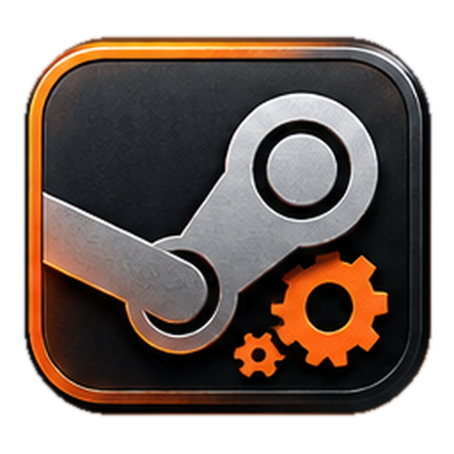
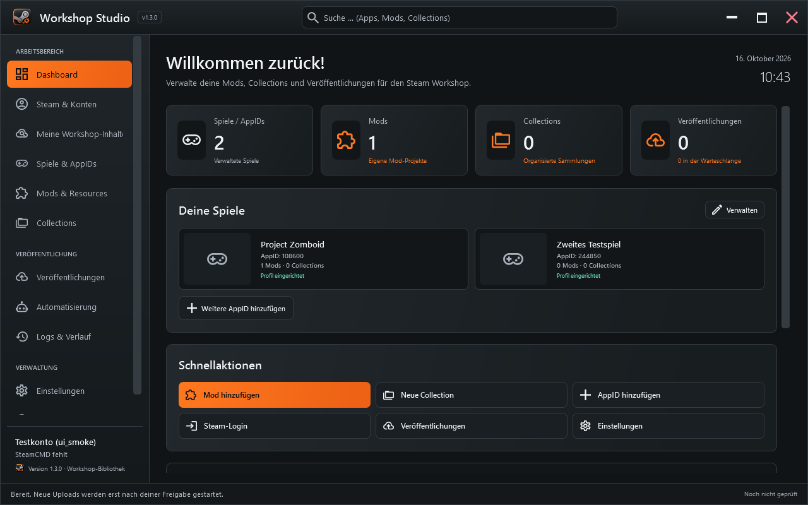

<p align="center"></p>
<h1 align="center">Workshop Studio</h1>
<p align="center">Deine lokalen Mods. Deine Workshop-Inhalte.<br>Ein Windows-Werkzeug, um eigene Mods zu finden, zu verwalten und gezielt im Steam Workshop zu erstellen oder zu aktualisieren.</p>

<p align="center">
  <a href="https://github.com/ZUMBYTE-AppSolution/WorkshopStudio/releases/download/v1.3.0/WorkshopStudio-1.3.0-win-x64.zip"><strong>Windows herunterladen</strong></a>
  · <a href="https://github.com/ZUMBYTE-AppSolution/WorkshopStudio/releases/latest">Alle Downloads</a>
  · <a href="README_DE.md">Ausführliche Anleitung</a>
  · <a href="https://github.com/ZUMBYTE-AppSolution/WorkshopStudio/wiki">Wiki</a>
</p>
<p align="center">
  <a href="https://github.com/ZUMBYTE-AppSolution/WorkshopStudio/releases"></a>
  <a href="https://github.com/ZUMBYTE-AppSolution/WorkshopStudio/actions/workflows/ci.yml"></a>
  <a href="CHANGELOG.md"></a>
</p>

> **Aktueller öffentlicher Stand: v1.3.0.** Die Anwendung läuft lokal unter Windows. Ein Steam-Upload startet erst nach deiner gezielten Freigabe im Tool.



## Was du damit machen kannst

| Aufgabe | In der App |
|---|---|
| **Eigene Workshop-Inhalte finden** | Mit deinem Steam-Konto anmelden, eigene Mods und Collections ermitteln und ihre Metadaten samt Workshop-ID übernehmen. |
| **Lokale Mods zuordnen** | Einen Stammordner wählen. Studio durchsucht Unterordner nach einzelnen B41- und B42-Mods und schlägt passende Workshop-Profile vor. |
| **Mods neu erstellen oder aktualisieren** | Eine neue Mod ohne Workshop-ID anlegen oder eine vorhandene ID nach Prüfung von Quelle, Ziel und Metadaten weiterverwenden. |
| **Metadaten automatisch mitnehmen** | Geänderte Beschreibung, aktuelle Changelog-Notiz, Versionshinweise und ausgewählte Bilder erkennen; bekannte Notizen werden nicht doppelt angehängt. |
| **Vor dem Update sichern** | Den bisherigen Steam-Inhalt samt Metadaten und Bild als geprüftes Backup speichern. Ohne erfolgreiche Sicherung startet kein Bestandsupload. |
| **Paket vorab prüfen** | Alle ausgewählten Dateien, Zielpfade, Größe und Prüfsummen ansehen. Ungewählte Nachbarordner und die Spielinstallation bleiben draußen. |
| **Config kopieren** | Gefundene Config-Dateien als echten, frei markierbaren Originaltext öffnen und kopieren. |
| **Tool aktualisieren** | Offizielle GitHub-Releases prüfen; Download und Installation werden separat bestätigt und per SHA-256 kontrolliert. |

## Windows-Installation

1. Lade das [portable Windows-x64-Paket](https://github.com/ZUMBYTE-AppSolution/WorkshopStudio/releases/download/v1.3.0/WorkshopStudio-1.3.0-win-x64.zip) herunter und entpacke es vollständig.
2. Starte `WorkshopStudio.exe` aus dem entpackten Ordner. Die .NET-Laufzeit ist enthalten; für die eingebettete Steam-Anmeldung wird WebView2 benötigt.
3. Melde dich unter **Steam & Konten** an. Unter **Meine Workshop-Inhalte** kannst du anschließend deine vorhandenen Einträge ermitteln und importieren.
4. Gehe zu **Mods & Resources → Mehrere Mods auswählen** und wähle den Ordner, in dem deine lokalen Mods liegen. Prüfe die vorgeschlagenen Zuordnungen, besonders die Workshop-IDs, bevor du sie übernimmst.
5. Öffne eine Mod, prüfe ihre Paketvorschau und veröffentliche erst nach bewusster Auswahl des Zielkanals.

Das Programm ist derzeit nicht signiert. Die portablen Dateien können in einem beschreibbaren Ordner ohne Installation verwendet werden. Bestehende Arbeitsbereichsdaten und Einstellungen liegen getrennt im Benutzerprofil.

## Hinweise zu deinen Daten

Studio paketiert ausschließlich die ausdrücklich ausgewählten Mods. Eine Spielinstallation, ungewählte Nachbarordner und fremde Workshop-Inhalte werden nicht als eigene Mods hochgeladen. Ein Import von Workshop-Metadaten lädt keine fremden Quelldateien herunter. Vor jedem Upload zeigt das Tool Quelle und Workshop-Ziel an; für neue Mods und Bestandsupdates gelten getrennte Prüfungen.

Die Anwendung ist besonders auf Project Zomboid B41/B42 vorbereitet. Andere Steam-AppIDs lassen sich verwalten; ihre konkreten Workshop-Anforderungen müssen mit dem jeweiligen Spiel geprüft werden. [Sicherheit](docs/SECURITY.md) · [Bekannte Grenzen](docs/KNOWN_LIMITATIONS.md)

## Entwicklungsstand

Der Windows-Build für v1.3.0 und 162 lokale Selbsttests waren erfolgreich. Die Oberfläche wurde mit einem isolierten Testarbeitsbereich gerendert, einschließlich kompakter Spielansicht, maximierter Fensterknöpfe, lokaler Mod-Zuordnung und kopierbarem Config-Text. Ein echter Steam-Upload sowie ein vollständiges Update von einer älteren veröffentlichten Version wurden noch nicht durchgeführt. [Prüfbericht](docs/DELIVERY_1.3.0.md) · [Changelog](CHANGELOG.md) · [Release-Aktion](https://github.com/ZUMBYTE-AppSolution/WorkshopStudio/actions/workflows/release.yml)

Für die Entwicklung werden Windows und das .NET 10 SDK benötigt:

```powershell
./scripts/Build.ps1
```

Das Skript baut die Anwendung, führt die Selbsttests aus und erstellt das Windows-ZIP. Ein Tag im Format `vMAJOR.MINOR.PATCH` startet den gleichen Release-Build auf GitHub Actions.

## Hilfe und Kontakt

[Ausführliche Anleitung](README_DE.md) · [Änderungen](CHANGELOG.md) · [Probleme melden](https://github.com/ZUMBYTE-AppSolution/WorkshopStudio/issues) · [Zumbyte](https://www.zumbyte.de/)

Das [vollständige Wiki](https://github.com/ZUMBYTE-AppSolution/WorkshopStudio/wiki) erklärt alle Bereiche einschließlich Automation, Metadatenentscheidungen und Wiederherstellung aus einem Backup.

Workshop Studio ist ein eigenständiges Projekt und steht nicht in Verbindung mit Valve oder The Indie Stone. Der Quellcode steht unter der [MIT-Lizenz](LICENSE); Hinweise zu verwendeten Komponenten stehen in [THIRD_PARTY_NOTICES.md](THIRD_PARTY_NOTICES.md).
